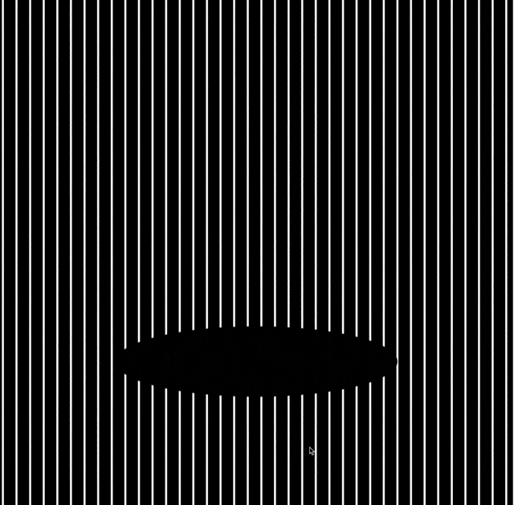

# Processing_moire_motion

Tools for making barrier-grid animations (also called scanimations or "moiré motion"):
a combined image made of interleaved strips of several frames, and a black grid with
clear slits that you lay on top. Slide the grid and the picture moves.



## Web app

**https://b2renger.github.io/Processing_moire_motion/**

Runs entirely in the browser, nothing is uploaded.

1. **Frames**: open a short video and set the start and end of one loop, or open
   several images (used in file-name order). *Black and white silhouettes* helps
   with photographic footage: high-contrast shapes read best through a grid.
2. **Pattern**: straight or curved lines in any direction, or a radial grid (straight
   rays or spirals) that animates by turning instead of sliding. Curved and radial
   grids follow [FabObscura](https://hcie.csail.mit.edu/research/fabobscura/fabobscura.html):
   a line is shifted sideways by `f(x)`; a ray leans by `f(r)` degrees.
3. **Print**: download the combined image and the grid. Both PNGs carry the chosen
   dpi, so they come out the same physical size.

Preview the result by playing it or by dragging across the picture (arrow keys
step one frame).

### Printing tips

- Print both files at 100% scale. Print the grid on transparency film (laser or inkjet).
- The grid is larger than the image so it keeps covering it while it moves: line
  up the centres.
- 4 to 8 frames work best. Each extra frame darkens the result, since only one
  strip in N is clear.
- Thin strips hide the trick better but need a sharp printer; around 0.3 to 0.5 mm
  per strip is a good start. Angled, curved and radial grids are drawn in pixels,
  so give them a few more pixels per strip than straight vertical lines.

### Publishing

The app is the static folder `docs/` (no build step). On GitHub: *Settings → Pages →
Deploy from a branch → `main` / `/docs`*. It also works by opening
`docs/index.html` straight from disk.

## Processing sketch

`moire_motion/` does the straight-line version in [Processing](https://processing.org).

- Put your frames in `moire_motion/data/`. They are read in file-name order, so name
  them `frame01.png`, `frame02.png`…
- Move the mouse to slide the grid. `SPACE` plays or pauses, `LEFT`/`RIGHT` step one
  frame, `G` shows or hides the grid, `S` saves `combined.png` and `grid.png` in
  the sketch folder.
- `stripWidth` sets the strip width; the window size is the output size.

## Tests

```
node --test test/moire.test.js
```

Checks that moving the grid by k strips (or turning it by k strip-angles) uncovers
frame k and nothing else, for straight, curved, angled and radial grids.

## Credits

Curved and radial grids are based on *FabObscura: Computational Design and
Fabrication for Interactive Barrier-Grid Animations*, Ticha Sethapakdi et al.,
UIST 2025 ([project page](https://hcie.csail.mit.edu/research/fabobscura/fabobscura.html),
[code](https://github.com/tichaesque/FabObscura), CC0).
